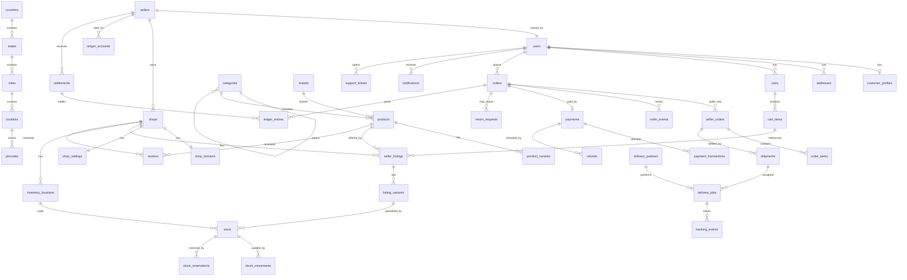

# 03 — Data Model

PostgreSQL 16 + PostGIS, Prisma ORM. UUID primary keys (`uuid_generate_v4()` /
`gen_random_uuid()`), `created_at`/`updated_at timestamptz` (UTC) on every table.
Human-readable external IDs: orders `APN-2026-000123`, shops `slug`.

## 0. Global rules

1. Every tenant-scoped table: `shop_id uuid NOT NULL REFERENCES shops(id)`
   + RLS policy `USING (shop_id = current_setting('app.current_tenant')::uuid)`.
2. Money: `bigint` **paise** (never float). Currency fixed `INR`.
3. Order/financial facts are snapshots; never join to live catalogue for history.
4. Enumerated lifecycles use Postgres `TEXT` + `CHECK` (Prisma-friendly) or native
   enums — one style per table, documented below as `enum`.
5. Soft delete only where legally required (audit-adjacent); otherwise status flags.
6. All list queries keyset-paginate by `(created_at, id)`.

## 1. ER overview



## 2. Geography

### `countries` / `states` / `cities` / `localities` / `pincodes`
| Table | Key columns |
|-------|-------------|
| `countries` | `id, iso_code, name, currency, phone_code` |
| `states` | `id, country_id, code, name, is_active` |
| `cities` | `id, state_id, name, slug, is_active, `geometry(Point,4326)` `center, timezone` |
| `localities` | `id, city_id, name, slug, `geometry(MultiPolygon,4326)` `boundary (nullable)` |
| `pincodes` | `id, city_id, pincode, `geometry(MultiPolygon,4326)` `boundary, is_serviceable` |

Indexes: `cities(state_id, slug)`, `localities(city_id, slug)`,
`pincodes(pincode)` unique, GIST on all geometry columns.

### `delivery_zones` (serviceability + pricing)
`id, city_id, name, zone_type enum(CIRCLE_RADIUS, POLYGON), center geometry,
radius_m int, boundary geometry, fee_paise bigint, free_above_paise bigint,
eta_min_minutes int, eta_max_minutes int, is_active`

## 3. Identity & tenancy

### `users`
`id, phone (unique, E.164), email (unique, nullable), password_hash (nullable),
name, locale enum(EN,HI) default 'EN', status enum(ACTIVE,BLOCKED,DELETED),
last_login_at, created_at, updated_at`

### `roles` / `permissions` / `user_roles` (RBAC)
`roles(id, name enum(SUPER_ADMIN,CITY_ADMIN,SELLER_OWNER,SELLER_STAFF,CUSTOMER,DELIVERY_PARTNER,CUSTOMER_SUPPORT), scope enum(PLATFORM,CITY,SHOP))`,
`permissions(id, code, description)`, `role_permissions(role_id, permission_id)`,
`user_roles(user_id, role_id, city_id?, shop_id?)`.
Role×permission matrix → `08-security-compliance.md`.

### `customer_profiles`
`id, user_id unique, default_address_id, gender, birth_date, marketing_consent bool`

### `addresses`
`id, user_id, label, line1, line2, landmark, locality_id, pincode,
latitude, longitude, is_default, created_at`

### `sellers`
`id, user_id, legal_name, display_name, business_type enum(INDIVIDUAL,PROPRIETORSHIP,partnership,LLP,PVT_LTD),
pan, gstin (nullable), status enum(DRAFT,KYC_PENDING,APPROVED,SUSPENDED,REJECTED),
kyc_submitted_at, approved_at, approved_by, payout_profile_id`

### `shops` (the tenant)
`id, seller_id, city_id, name, slug (unique), logo_media_id, banner_media_id,
description, category_ids uuid[], status enum(PENDING,ACTIVE,SUSPENDED,CLOSED),
rating_avg numeric(3,2), rating_count int, opened_at, closed_at, created_at`

### `shop_domains`
`id, shop_id, host (unique) — e.g. 'bagga-cloth.apnacity.com',
host_type enum(SUBDOMAIN,CUSTOM), verified_at, ssl_status enum(PENDING,ACTIVE,FAILED)`

### `shop_settings`
`id, shop_id, delivery_mode enum(SELF,PLATFORM,BOTH), self_delivery bool,
pickup_address_id, opening_hours jsonb, return_policy_text, min_order_paise,
commission_rate_override numeric(5,2) nullable, locale, theme jsonb`

## 4. Catalogue

### `categories`
`id, parent_id (self FK), name, slug, path ltree (e.g. `root.men.shirts`),
attribute_schema jsonb, icon_media_id, sort_order, is_active, requires_approval bool`

`attribute_schema` example: `[{"key":"size","type":"enum","values":["S","M","L","XL"],"required":true},
{"key":"color","type":"string","required":true}]` — drives the seller wizard and
variant generation. Category changes are versioned (schema snapshots on products).

### `brands`
`id, name, slug, logo_media_id, is_active`

### `products` (master — shared across shops)
`id, category_id, brand_id (nullable), name, slug, description,
gtin (nullable, unique when present), attributes jsonb,
status enum(DRAFT,PENDING_REVIEW,ACTIVE,INACTIVE),
match_group_id (nullable — duplicate-merge queue),
created_by (seller or admin), created_at, updated_at`
Indexes: `gin(to_tsvector('simple', name || ' ' || description))`, `gtin`, `slug`.

### `product_variants`
`id, product_id, sku (unique platform-wide), attributes jsonb ({"size":"M","color":"Blue"}),
weight_grams, dimensions_mm jsonb, barcode (nullable), is_active`
A variant = a comparable unit. **Price comparison matches on
`(product_id, variant_id)` — size 8 never compares against size 10.**

### `product_media`
`id, product_id nullable, variant_id nullable, shop_id nullable,
media_id, sort_order, is_primary` — media blobs live in `media`.

## 5. Seller listings & inventory

### `seller_listings` (a shop's offer for a master product)
`id, shop_id, product_id, title_override (nullable), status enum(DRAFT,PAUSED,ACTIVE,OUT_OF_STOCK,REJECTED),
listed_at, deactivated_at, created_at, updated_at`
Unique `(shop_id, product_id)`. Index `(shop_id, status)`, `(product_id, status)`.

### `listing_variants` (per-variant price & stock pointer)
`id, listing_id, variant_id, seller_sku, mrp_paise, price_paise,
tax_rate_bp (basis points), stock_tracked bool, is_active`
Check: `price_paise <= mrp_paise`. Unique `(listing_id, variant_id)`, `(shop_id, seller_sku)`.

### `inventory_locations`
`id, shop_id, name (default 'Shop Floor'), address_id, is_default, is_active`

### `stock`
`id, location_id, listing_variant_id, quantity_on_hand int, quantity_reserved int,
reorder_level int, updated_at`
Check: `quantity_on_hand >= quantity_reserved`.
**Available = `quantity_on_hand - quantity_reserved` — reserved is incremented by
atomic conditional update:**
```sql
UPDATE stock SET quantity_reserved = quantity_reserved + $qty
WHERE id = $id AND (quantity_on_hand - quantity_reserved) >= $qty
RETURNING *;   -- 0 rows ⇒ insufficient stock ⇒ reject
```

### `stock_movements` (append-only audit)
`id, stock_id, delta_on_hand int, delta_reserved int,
reason enum(ORDER_RESERVE,ORDER_RELEASE,ORDER_SALE,DELIVERY,RETURN,MANUAL_ADJUST,IMPORT,CORRECTION),
reference_type, reference_id, actor_user_id, created_at`

### `stock_reservations`
`id, stock_id, order_item_id, quantity, status enum(ACTIVE,RELEASED,CONSUMED),
expires_at, created_at` — TTL job (`order-timers`) releases expired reservations.

## 6. Cart & checkout

### `carts`
`id, user_id, city_id, status enum(OPEN,ORDERED,ABANDONED), coupon_code (nullable),
updated_at` — one open cart per user (unique partial index on `user_id WHERE status='OPEN'`).

### `cart_items`
`id, cart_id, listing_variant_id, listing_id, shop_id, quantity,
added_price_paise (snapshot, revalidated at checkout), created_at`

Checkout computes: group items by `shop_id` → per-shop delivery fee (zone + distance
slab) → coupon applicability (platform vs shop-scoped) → grand total → payment intent.
Price/stock drift at checkout → item-level error surfaced to client, never silent.

## 7. Orders

### `orders` (parent)
`id, order_no (unique, APN-2026-000123), user_id, city_id, address_snapshot jsonb
(line1..pincode, lat, lng), items_total_paise, delivery_total_paise,
discount_paise, tax_total_paise, grand_total_paise, currency 'INR',
status enum(PENDING_PAYMENT,PLACED,PARTIALLY_CANCELLED,COMPLETED,CANCELLED),
payment_id, placed_at, completed_at, cancelled_at, cancellation_reason, created_at`

### `seller_orders` (child — one per shop)
`id, order_id, shop_id, seller_order_no, items_total_paise, delivery_fee_paise,
tax_total_paise, commission_paise, seller_net_paise,
status enum(NEW,ACCEPTED,REJECTED,PREPARING,READY,DISPATCHED,OUT_FOR_DELIVERY,DELIVERED,CLOSED,CANCELLED,RETURN_REQUESTED,RETURNED),
accept_deadline_at, accepted_at, rejected_reason, delivered_at, closed_at`
Unique `(shop_id, seller_order_no)`. Index `(order_id)`, `(shop_id, status, created_at)`.

### `order_items`
`id, seller_order_id, order_id, listing_variant_id, product_id, variant_id,
quantity, unit_price_paise (snapshot), mrp_paise, tax_rate_bp, tax_amount_paise,
line_total_paise, name_snapshot, sku_snapshot, image_media_id, weight_grams,
status enum(NORMAL,CANCELLED,RETURNED,EXCHANGED)`
> Snapshot columns make order history immune to listing edits/deletions.

### `order_events` (immutable history)
`id, order_id nullable, seller_order_id nullable, order_item_id nullable,
event enum(PLACED,PAYMENT_CONFIRMED,PAYMENT_FAILED,SELLER_NOTIFIED,SELLER_ACCEPTED,
SELLER_REJECTED,CANCELLED_BY_CUSTOMER,CANCELLED_BY_SELLER,CANCELLED_BY_ADMIN,
PARTIAL_CANCEL,PREPARING,READY,DISPATCHED,OUT_FOR_DELIVERY,DELIVERED,OTP_VERIFIED,
POD_UPLOADED,COMPLETED,RETURN_REQUESTED,RETURN_APPROVED,RETURN_REJECTED,
RETURN_PICKED,REFUND_INITIATED,REFUND_COMPLETED,DISPUTE_OPENED,DISPUTE_RESOLVED),
from_status, to_status, actor_type enum(CUSTOMER,SELLER,RIDER,ADMIN,SYSTEM),
actor_id, payload jsonb, created_at`
Append-only; every transition writes exactly one row (enforced in service layer).

## 8. Payments & finance

### `payments`
`id, order_id, provider enum(CASHFREE,RAZORPAY,COD), provider_order_ref,
amount_paise, currency 'INR', method enum(UPI,CARD,NETBANKING,WALLET,COD),
status enum(CREATED,AUTHORIZED,CAPTURED,FAILED,REFUNDED,PARTIALLY_REFUNDED),
captured_at, idempotency_key, created_at`

### `payment_transactions`
`id, payment_id, provider_txn_ref, type enum(CREATE,CAPTURE,REFUND,STATUS),
status, amount_paise, raw_payload jsonb, signature_verified bool, created_at`

### `refunds`
`id, payment_id, seller_order_id nullable (partial refund scope), order_item_id nullable,
amount_paise, reason, status enum(REQUESTED,APPROVED,INITIATED,COMPLETED,FAILED),
provider_ref, initiated_by, completed_at, created_at`

### `ledger_accounts`
`id, owner_type enum(PLATFORM,SELLER,DELIVERY_PARTNER,CUSTOMER), owner_id,
account_type enum(RECEIVABLE,PAYABLE,COMMISSION_INCOME,DELIVERY_INCOME,GATEWAY_FEE,
TAX_COLLECTED,COD_HOLDING,REFUND_CLAIM), currency 'INR', balance_paise bigint`
Index `(owner_type, owner_id, account_type)` unique.

### `ledger_entries` (append-only double-entry)
`id, transaction_id (groups both sides of a posting), entry_no,
ledger_account_id, debit_paise, credit_paise, source_type, source_id,
memo, settlement_id nullable, created_by, created_at`
Rule: **sum(debit) = sum(credit) per `transaction_id`** (DB trigger enforces).
Posting points: payment captured, commission earned, gateway fee, delivery fee,
refund, COD collected, settlement payout. Never updated, never deleted.

### `settlements`
`id, seller_id, period_start, period_end, gross_sales_paise, commission_paise,
delivery_paise, refunds_paise, tcs_paise, adjustments_paise, net_paise,
status enum(PENDING,PROCESSING,PAID,FAILED), provider_payout_ref, utr,
paid_at, statement_no, created_at`
### `settlement_items`
`id, settlement_id, seller_order_id, amount_paise, breakdown jsonb`

## 9. Delivery

### `delivery_partners`
`id, user_id, city_id, vehicle enum(BIKE,SCOOTER,BICYCLE,TEMPO,WALK),
kyc_status enum(PENDING,APPROVED,REJECTED), bank_account_id,
is_available bool, last_location geometry(Point,4326), last_seen_at,
current_job_id nullable, rating_avg, rating_count, created_at`

### `delivery_partner_zones`
`id, delivery_partner_id, locality_id` — preferred working areas.

### `delivery_jobs`
`id, seller_order_id, type enum(FORWARD,RETURN_PICKUP), mode enum(PLATFORM_RIDER,SELLER_SELF),
status enum(UNASSIGNED,ASSIGNED,ACCEPTED,RIDER_REJECTED,AT_PICKUP,PICKED_UP,
IN_TRANSIT,AT_DROP,DELIVERED,FAILED,RETURNED_TO_SELLER,CANCELLED),
delivery_partner_id nullable, pickup_location geometry, drop_location geometry,
distance_m int, fee_paise bigint (rider payout), eta_minutes int,
otp_hash (customer OTP), assignment_reason jsonb, assigned_at, expires_at,
picked_up_at, delivered_at, failed_reason, created_at`

### `tracking_events`
`id, delivery_job_id, delivery_partner_id, event enum(ASSIGNED,ACCEPTED,REJECTED,
AT_PICKUP,PICKED_UP,IN_TRANSIT_PING,AT_DROP,OTP_VERIFIED,POD_UPLOADED,DELIVERED,FAILED),
location geometry, payload jsonb, created_at` (rider GPS pings throttled 15 s)

### `shipment_links` (reverse logistics / exchange)
`id, forward_job_id, return_job_id, exchange_seller_order_id`

### `proof_of_delivery`
`id, delivery_job_id, media_id nullable, otp_verified bool, signature_media_id,
signed_by_name, delivered_to_relation, created_at`

## 10. Returns & reviews

### `return_requests`
`id, seller_order_id, order_item_id, user_id, reason enum(DAMAGED,WRONG_ITEM,
NOT_AS_DESCRIBED,SIZE_ISSUE,CHANGED_MIND,LATE_DELIVERY,OTHER),
comments, media_ids uuid[], status enum(REQUESTED,APPROVED,REJECTED,PICKUP_SCHEDULED,
PICKED_UP,RECEIVED,INSPECTION_PASSED,INSPECTION_FAILED,REFUND_INITIATED,COMPLETED,CANCELLED),
requested_at, window_expires_at (policy per category), refund_id, resolution_note`

### `reviews`
`id, user_id, seller_order_id (verified purchase link), order_item_id,
product_id, shop_id, rating (1–5, CHECK), title, body, media_ids uuid[],
status enum(PENDING,APPROVED,REJECTED), moderation_reason, created_at`
Denormalised aggregates: `products.rating_avg/count`, `shops.rating_avg/count`
(recomputed on approval — exact, not incremental).

## 11. Promotions

### `coupons`
`id, scope enum(PLATFORM,CITY,SHOP), city_id?, shop_id?, code (unique per scope),
type enum(PERCENT,FLAT,FREE_DELIVERY), value_bp / value_paise,
min_order_paise, max_discount_paise, usage_limit, per_user_limit,
valid_from, valid_to, is_active`

### `coupon_redemptions`
`id, coupon_id, user_id, order_id, discount_paise, created_at` (unique `(coupon_id,user_id,order_id)`)

### `campaigns` / `sponsored_placements` (Phase 7)
City landing banners, boosted listings with budget/caps.

## 12. Notifications & support

### `notification_templates`
`id, code (e.g. ORDER_PLACED_SELLER), channel enum(SMS,WHATSAPP,PUSH,EMAIL,INAPP),
locale enum(EN,HI), body_template, dlt_template_id (SMS — mandatory in India),
whatsapp_template_name, variables jsonb, is_active`

### `notifications`
`id, user_id, template_code, channel, payload jsonb, status enum(QUEUED,SENT,
FAILED,SUPPRESSED), sent_at, error, created_at` (suppressed if user opted out)

### `notification_preferences`
`user_id, channel, topic enum(ORDERS,PROMOS,ACCOUNT), opted_in bool` (default: ORDERS on, PROMOS off)

### `support_tickets`
`id, ticket_no, opened_by_user_id, type enum(CUSTOMER_COMPLAINT,SELLER_ISSUE,
REFUND_ESCALATION,RETURN_DISPUTE,DELIVERY_ISSUE,OTHER), order_id?, seller_order_id?,
subject, description, priority enum(LOW,MEDIUM,HIGH,URGENT), status enum(OPEN,
IN_PROGRESS,AWAITING_CUSTOMER,RESOLVED,CLOSED,ESCALATED), assigned_to,
sla_due_at, resolved_at, created_at`

### `ticket_messages`
`id, ticket_id, sender_type enum(CUSTOMER,SELLER,AGENT,SYSTEM), sender_id,
body, media_ids uuid[], created_at`

## 13. System

### `media`
`id, owner_user_id, shop_id?, kind enum(PRODUCT_IMAGE,LOGO,BANNER,POD,DOCUMENT),
storage_key, mime, width, height, size_bytes, variants jsonb ({"256":"…","512":"…","1024":"…"}),
scan_status enum(PENDING,CLEAN,REJECTED), created_at`

### `audit_logs` (append-only)
`id, actor_user_id, actor_role, action (e.g. SELLER_ORDER_CANCEL),
entity_type, entity_id, shop_id?, before jsonb, after jsonb, ip, user_agent, created_at`

### `outbox_events`
`id, aggregate_type, aggregate_id, event_type (order.placed.v1), payload jsonb,
status enum(PENDING,DISPATCHED,FAILED,DEAD), attempts, next_attempt_at, dispatched_at`

### `idempotency_keys`
`key (pk), user_id, endpoint, request_hash, response_status, response_body, created_at, expires_at`

### `webhook_events` (inbound)
`id, provider, event_type, external_ref, signature_valid bool, raw_payload jsonb,
processed_at, processing_error`

### `feature_flags`
`key (pk), description, default_enabled bool, rules jsonb (per-city/shop/user %), updated_by`

### `analytics_events` (partitioned monthly, append-only)
`id, event_type (search, product_view, add_to_cart, checkout_start, order_placed…),
user_id?, city_id, shop_id?, session_id, payload jsonb, created_at`

### `search_synonyms`
`id, term, synonyms text[], locale`

## 14. Row-Level Security example (all tenant tables)

```sql
ALTER TABLE seller_listings ENABLE ROW LEVEL SECURITY;
CREATE POLICY tenant_isolation ON seller_listings
  USING (shop_id = NULLIF(current_setting('app.current_tenant'), '')::uuid);
```
The API sets `app.current_tenant` per request from the verified tenant context.
Admin service role bypasses RLS via a dedicated `SET LOCAL ROLE admin_service`.

## 15. Prisma & migrations

- Single `packages/db/prisma/schema.prisma`; extensions (PostGIS, ltree, RLS,
  triggers) as raw SQL migrations in `packages/db/prisma/migrations/*__*.sql`.
- Every migration must be **reversible** and reviewed; `migrate deploy` in CI;
  `migrate dev` locally only.
- Seed script: 2 states, 5 cities, 20 localities, 50 pincodes, 3 shops,
  200 products, demo customer/rider/admin accounts (Hindi + English strings).


